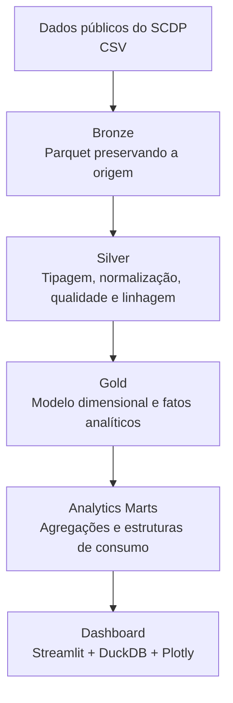

# Inteligência Analítica de Viagens

Projeto de **Business Intelligence, Engenharia de Dados e Visualização Analítica** desenvolvido no contexto da disciplina **Projeto Integrador V-A**, com análise histórica de dados públicos de viagens corporativas do **Sistema de Concessão de Diárias e Passagens (SCDP)** entre **2022 e 2025**.

A solução implementa um pipeline analítico em camadas, utilizando **Python, DuckDB e Parquet**, desde o tratamento dos dados brutos até a construção de um modelo dimensional e de Analytics Marts. Os resultados são disponibilizados em um **dashboard interativo desenvolvido com Streamlit e Plotly**.

O projeto foi desenvolvido em contexto acadêmico com participação da empresa parceira **DATABURGO BRASIL TECNOLOGIA LTDA.** Os dados utilizados na solução são públicos e não correspondem a dados internos ou confidenciais da empresa parceira.

---

## Visão geral

O projeto transforma dados públicos de viagens em uma solução analítica capaz de responder questões relacionadas a:

- volume de processos de viagem;
- gastos com pagamentos;
- despesas com passagens;
- despesas com diárias;
- antecedência de emissão;
- viagens classificadas como urgentes;
- evolução histórica dos indicadores;
- principais rotas e destinos;
- meios de transporte utilizados;
- comportamento de órgãos e unidades administrativas;
- cobertura das informações;
- qualidade e consistência dos dados.

A arquitetura foi projetada para preservar as diferentes granularidades das fontes, evitar multiplicações indevidas de valores e manter rastreabilidade entre os dados originais e os indicadores apresentados no dashboard.

---

## Principais números

O conjunto histórico processado contém mais de **16,5 milhões de registros**, distribuídos entre quatro domínios principais:

| Domínio | Registros |
|---|---:|
| Viagem | 3.110.752 |
| Trecho | 6.796.916 |
| Passagem | 1.495.554 |
| Pagamento | 5.192.389 |
| **Total** | **16.595.611** |

Após os processos de modelagem e validação, o modelo analítico possui **3.110.745 processos de viagem** no período considerado.

Entre os indicadores consolidados no dashboard estão:

- aproximadamente **R$ 8,87 bilhões** em pagamentos;
- aproximadamente **R$ 3,18 bilhões** em passagens;
- aproximadamente **R$ 5,65 bilhões** em diárias;
- **14 dias** de antecedência mediana;
- aproximadamente **59,6%** dos registros válidos de antecedência classificados na faixa de urgência adotada pelo projeto.

---

## Escopo temporal

O período histórico principal é:

```text
2022–2025
```

O ano de **2026 não integra as comparações históricas**, pois o período disponível no momento da construção do projeto estava incompleto.

Essa decisão evita comparar um exercício parcial com anos completos.

---

## Arquitetura da solução



A arquitetura segue uma organização em camadas:

### Bronze

Preserva os dados de origem em formato analítico, oferecendo uma base estável para as etapas posteriores.

### Silver

Responsável por:

- consolidação dos anos;
- conversão de tipos;
- normalização de valores;
- tratamento semântico;
- criação de chaves técnicas;
- controle de linhagem;
- preservação da multiplicidade original;
- preparação dos dados para modelagem.

### Gold

Implementa estruturas dimensionais e fatos analíticos com granularidades específicas para:

- processos;
- pagamentos;
- passagens;
- trechos.

### Analytics Marts

Produz estruturas otimizadas para consumo pelo dashboard, reduzindo a necessidade de carregar as tabelas factuais completas durante a utilização da aplicação.

### Dashboard

Disponibiliza os indicadores por meio de uma aplicação web interativa em Streamlit.

---

## Tecnologias

As principais tecnologias utilizadas são:

- **Python**
- **DuckDB**
- **Apache Parquet**
- **Pandas**
- **Streamlit**
- **Plotly**
- **Git**
- **GitHub**

### Por que DuckDB e Parquet?

A combinação DuckDB + Parquet permite realizar consultas analíticas diretamente sobre arquivos colunares, oferecendo boa eficiência para agregações e filtros sem exigir a implantação de um servidor de banco de dados dedicado.

Essa abordagem também facilita a portabilidade da solução e a separação entre processamento, armazenamento analítico e camada de apresentação.

---

## Modelo analítico

A solução preserva granularidades distintas:

```text
Processo     → uma observação analítica por processo e ano
Pagamento    → registros financeiros
Passagem     → registros de passagem
Trecho       → segmentos de deslocamento
```

Essas estruturas não são combinadas por meio de um único join plano.

Essa decisão é importante porque um mesmo processo pode possuir diversos pagamentos, passagens e trechos. A combinação direta dessas relações poderia produzir multiplicação de linhas e, consequentemente, distorcer medidas financeiras e operacionais.

---

## Estrutura do repositório

```text
Projeto/
│
├── .streamlit/
│   └── config.toml
│
├── dashboard/
│   ├── __init__.py
│   ├── charts.py
│   ├── components.py
│   ├── config.py
│   ├── data.py
│   └── formatters.py
│
├── pages/
│   ├── 1_Visao_Executiva.py
│   ├── 2_Gastos_Pagamentos.py
│   ├── 3_Antecedencia_Custo.py
│   ├── 4_Rotas_Modais.py
│   ├── 5_Orgaos_Operacao.py
│   └── 6_Qualidade_Metodologia.py
│
├── data/
│   └── gold/
│       └── marts/
│           ├── mart_antecedencia.parquet
│           ├── mart_antecedencia_detalhe.parquet
│           ├── mart_executivo_anual.parquet
│           ├── mart_gastos_categoria.parquet
│           ├── mart_modais.parquet
│           ├── mart_orgaos.parquet
│           ├── mart_qualidade_dados.parquet
│           └── mart_rotas.parquet
│
├── 01_build_silver.py
├── 02_validate_silver.py
├── 03_reconciliacao_financeira.py
├── 04_build_gold_model.py
├── 05_validate_gold.py
├── 06_build_analytics_marts.py
├── requirements.txt
├── streamlit_app.py
└── README.md
```

Os **Analytics Marts necessários para executar o dashboard público** fazem parte do repositório.

As bases completas utilizadas para reconstruir as camadas Silver e Gold são mantidas separadamente devido ao seu volume e não são necessárias para consultar o dashboard publicado.

---

## Analytics Marts

A aplicação pública utiliza oito arquivos analíticos:

```text
mart_executivo_anual.parquet
mart_gastos_categoria.parquet
mart_antecedencia.parquet
mart_antecedencia_detalhe.parquet
mart_orgaos.parquet
mart_rotas.parquet
mart_modais.parquet
mart_qualidade_dados.parquet
```

Esses marts representam a camada de consumo do projeto.

O uso dessa camada permite disponibilizar o dashboard sem publicar as grandes tabelas factuais utilizadas durante o processamento completo.

---

## Pipeline de dados

### 1. Construção da Silver

```powershell
python 01_build_silver.py
```

Responsável por:

- união dos períodos históricos;
- conversão e padronização de tipos;
- normalização semântica;
- geração de chaves técnicas;
- preservação da multiplicidade;
- controle de linhagem.

---

### 2. Validação da Silver

```powershell
python 02_validate_silver.py
```

Verifica, entre outros aspectos:

- contagens;
- chaves;
- erros de parsing;
- multiplicidade;
- categorias;
- consistência de totais financeiros.

---

### 3. Reconciliação financeira

```powershell
python 03_reconciliacao_financeira.py
```

Compara informações financeiras entre os domínios de:

- Viagem;
- Passagem;
- Pagamento.

A reconciliação é realizada tanto no nível dos processos quanto de forma agregada.

---

### 4. Construção da Gold

```powershell
python 04_build_gold_model.py
```

Constrói o modelo dimensional e os fatos analíticos utilizados pelo projeto.

A implementação utiliza processamento orientado ao DuckDB e configurações controláveis de memória e paralelismo para permitir a execução sobre conjuntos de dados de grande volume.

---

### 5. Validação da Gold

```powershell
python 05_validate_gold.py
```

Realiza verificações relacionadas a:

- unicidade das chaves;
- integridade referencial;
- reconciliação financeira;
- antecedência;
- cobertura;
- processos repetidos;
- exceções financeiras;
- dimensão de datas.

---

### 6. Construção dos Analytics Marts

```powershell
python 06_build_analytics_marts.py
```

Essa etapa converte as informações consolidadas da Gold em estruturas especializadas para consumo analítico e utilização pelo dashboard.

---

## Ordem recomendada de execução do pipeline completo

```text
01_build_silver.py
        ↓
02_validate_silver.py
        ↓
03_reconciliacao_financeira.py
        ↓
04_build_gold_model.py
        ↓
05_validate_gold.py
        ↓
06_build_analytics_marts.py
        ↓
streamlit_app.py
```

---

## Dashboard interativo

O projeto possui uma aplicação multipágina construída em Streamlit.

A navegação é dividida em seis perspectivas analíticas.

### 1. Visão Executiva

Apresenta uma síntese dos principais indicadores:

- processos de viagem;
- pagamentos;
- passagens;
- diárias;
- urgência;
- antecedência;
- evolução histórica.

### 2. Gastos e Pagamentos

Explora:

- valores financeiros;
- composição dos pagamentos;
- categorias de despesa;
- evolução temporal;
- cobertura do detalhamento de passagens.

### 3. Antecedência e Custo

Analisa a relação entre:

- data de emissão;
- início da viagem;
- antecedência;
- faixas de prazo;
- custo das passagens.

### 4. Rotas e Modais

Permite explorar:

- países;
- unidades da Federação;
- origens;
- destinos;
- rotas;
- meios de transporte.

### 5. Órgãos e Operação

Apresenta indicadores financeiros e operacionais sob diferentes estruturas administrativas.

### 6. Qualidade e Metodologia

Documenta:

- cobertura dos dados;
- exceções;
- controles;
- decisões metodológicas;
- limitações da análise.

---

## Execução local do dashboard

### 1. Clone o repositório

```powershell
git clone <URL-DO-REPOSITORIO>
cd inteligencia-analitica-viagens
```

### 2. Crie um ambiente virtual

```powershell
python -m venv .venv
```

### 3. Ative o ambiente

No Windows PowerShell:

```powershell
.\.venv\Scripts\Activate.ps1
```

### 4. Instale as dependências

```powershell
python -m pip install -r requirements.txt
```

### 5. Execute a aplicação

```powershell
python -m streamlit run .\streamlit_app.py
```

A aplicação ficará disponível localmente, normalmente em:

```text
http://localhost:8501
```

Nenhum conjunto adicional de dados é necessário para utilizar o dashboard, pois os Analytics Marts de consumo público estão incluídos no repositório.

---

## Reprodução do pipeline completo

Para reconstruir as camadas analíticas a partir das fontes originais, é necessário disponibilizar localmente a estrutura completa de dados.

Exemplo:

```text
Fonte de dados/
├── parquet/
├── silver/
└── gold/
    ├── marts/
    └── _metadata/
```

O diretório pode ser informado por meio da variável de ambiente:

```text
PI_DATA_ROOT
```

### PowerShell

Exemplo:

```powershell
$env:PI_DATA_ROOT = "C:\caminho\para\Fonte de dados"
```

Em seguida, execute o pipeline na ordem documentada anteriormente.

---

## Configurações opcionais do DuckDB

A construção e validação da camada Gold permitem controlar recursos utilizados pelo DuckDB por meio de variáveis de ambiente.

### Quantidade de threads

```text
PI_DUCKDB_THREADS
```

### Limite de memória

```text
PI_DUCKDB_MEMORY_LIMIT
```

### Diretório temporário

```text
PI_DUCKDB_TEMP_DIR
```

Exemplo em PowerShell:

```powershell
$env:PI_DUCKDB_THREADS = "1"
$env:PI_DUCKDB_MEMORY_LIMIT = "4GB"
$env:PI_DUCKDB_TEMP_DIR = "C:\temp\duckdb"
```

Essas configurações permitem adaptar o processamento à capacidade do ambiente utilizado.

---

## Regras financeiras

A principal referência para análise financeira consolidada é o domínio de pagamentos.

As categorias utilizadas incluem:

```text
PASSAGEM
DIARIAS
RESTITUICAO
SEGURO
```

O domínio de Passagem é utilizado para análises mais detalhadas relacionadas a:

- valor de passagem;
- taxa de serviço;
- modal;
- emissão;
- antecedência.

O detalhamento das passagens possui **cobertura parcial** em relação ao universo financeiro classificado como `PASSAGEM`.

Por esse motivo, as duas estruturas possuem funções analíticas distintas e não são tratadas como equivalentes.

---

## Antecedência

A antecedência é calculada pela diferença entre:

```text
Data de início da viagem − Data de emissão
```

As faixas utilizadas no projeto são:

```text
0–3 dias
4–7 dias
8–14 dias
15–30 dias
Mais de 30 dias
```

Emissões registradas posteriormente ao início da viagem permanecem identificadas separadamente.

Elas não são automaticamente classificadas como erro porque os dados disponíveis, isoladamente, não permitem determinar a causa de cada ocorrência.

---

## Multiplicidade dos registros

Registros exatamente iguais encontrados nas fontes não são removidos automaticamente.

Sem um identificador transacional único capaz de diferenciar cada ocorrência, a repetição de um registro não é evidência suficiente para afirmar que se trata de uma duplicidade indevida.

Por isso, a solução:

- preserva a multiplicidade original;
- identifica ocorrências relevantes;
- mantém controles de qualidade;
- evita alterações que não possam ser justificadas pelos dados.

---

## Qualidade e integridade

A camada Gold foi validada considerando, entre outros controles:

- integridade referencial;
- unicidade das chaves dimensionais;
- preservação das granularidades;
- reconciliação financeira;
- cobertura dos dados;
- consistência das datas;
- exceções de antecedência;
- processos com características atípicas.

As tabelas factuais finais não apresentam referências órfãs em relação às dimensões utilizadas pelo modelo.

---

## Privacidade

O dashboard público não expõe:

- CPF;
- nome individual dos viajantes.

As análises são apresentadas de forma agregada e utilizam identificadores técnicos apenas quando necessários ao processamento analítico.

O projeto utiliza dados públicos e não contém informações internas da empresa parceira.

---

## Limitações analíticas

Os resultados devem ser interpretados considerando algumas limitações importantes.

A solução não assume automaticamente que:

- repetição exata representa duplicidade indevida;
- emissão posterior ao início da viagem representa erro;
- o detalhamento de Passagem cobre todos os pagamentos classificados como passagem;
- associação entre antecedência e custo representa causalidade;
- diferenças observadas entre grupos representam, isoladamente, eficiência ou ineficiência operacional.

O dashboard tem finalidade exploratória e analítica e deve ser interpretado em conjunto com o contexto dos dados.

---

## Validação do código

Para verificar a sintaxe dos principais módulos:

```powershell
python -m compileall dashboard pages streamlit_app.py
```

Para validar as dependências instaladas:

```powershell
python -m pip check
```

---

## Execução pública

A arquitetura do repositório foi preparada para que o dashboard possa ser executado diretamente em ambiente de publicação utilizando apenas:

```text
código da aplicação
        +
Analytics Marts públicos
```

As tabelas intermediárias e fatos completos não precisam ser distribuídos juntamente com a aplicação.

Isso reduz o volume necessário para implantação e mantém separadas as camadas de processamento e de consumo.

---

## Contexto acadêmico

Este projeto foi desenvolvido como parte da disciplina **Projeto Integrador V-A**, aplicando conceitos de:

- Business Intelligence;
- Engenharia de Dados;
- modelagem dimensional;
- qualidade de dados;
- análise exploratória;
- visualização de dados;
- desenvolvimento de dashboards;
- processamento analítico.

A solução foi construída para aproximar o trabalho acadêmico de uma arquitetura utilizada em projetos reais de dados.

---

## Resultado

O projeto entrega uma solução analítica completa que integra:

```text
Dados públicos
      ↓
Engenharia de dados
      ↓
Qualidade e validação
      ↓
Modelagem dimensional
      ↓
Analytics Marts
      ↓
Business Intelligence
      ↓
Dashboard interativo
```

O resultado combina processamento de mais de **16,5 milhões de registros**, controles de qualidade, modelagem analítica e uma interface interativa destinada à exploração dos indicadores de viagens.

---

## Próximas evoluções

Entre possíveis extensões do projeto estão:

- automatização periódica da ingestão de novos exercícios;
- ampliação dos indicadores temporais;
- análises estatísticas adicionais;
- avaliação de modelos preditivos;
- criação de testes automatizados adicionais;
- incorporação de mecanismos de atualização incremental.

---

## Observação sobre os dados

Os dados analisados são provenientes de fontes públicas.

A participação da empresa parceira no contexto acadêmico do projeto não significa que os dados apresentados tenham sido fornecidos por ela nem que representem sua operação interna.

---